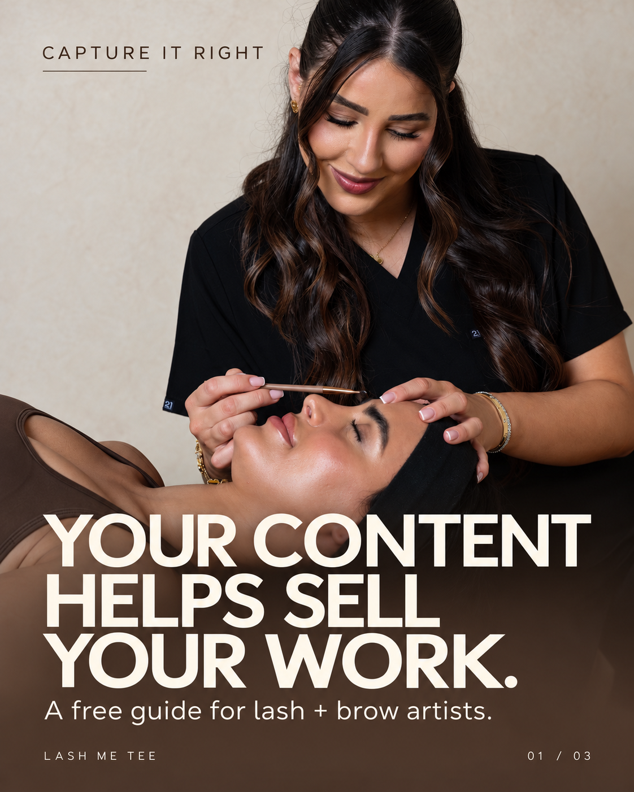
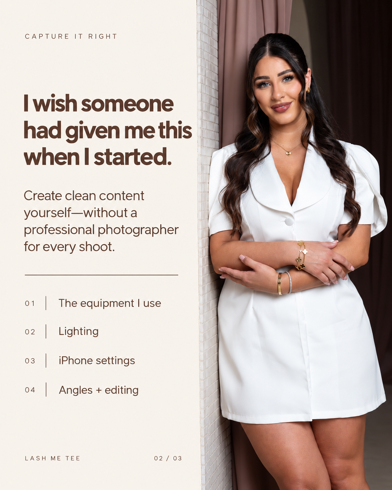
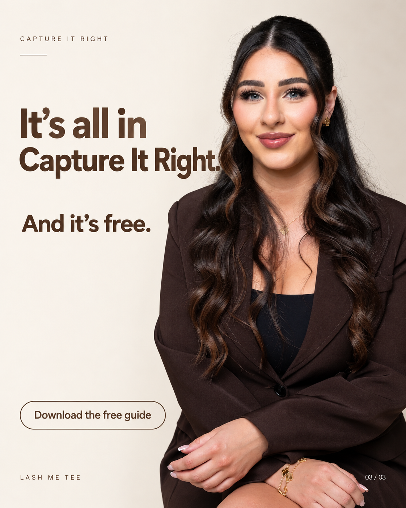
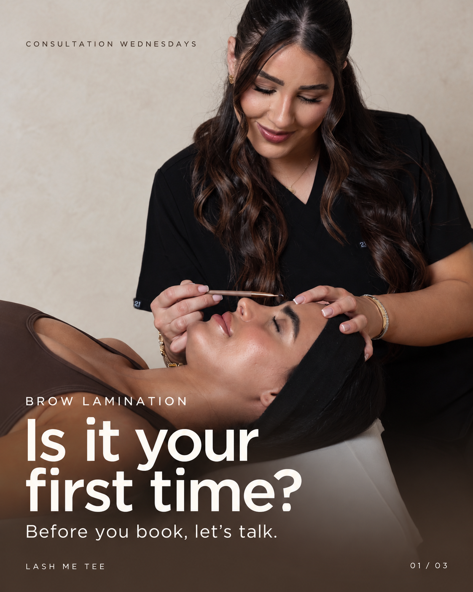
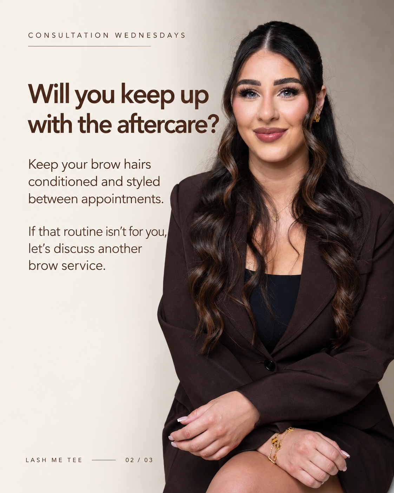
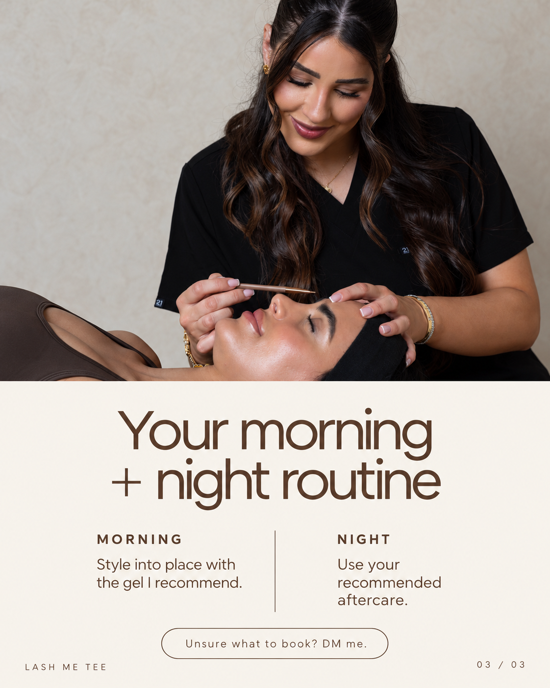
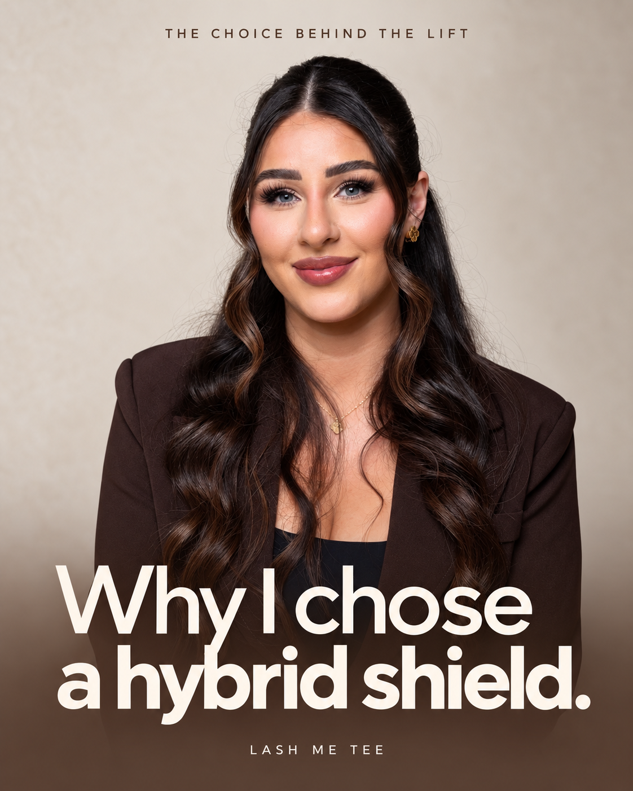

# LashMeTee — first three content posts

Review drafts from the supplied two-week brief. This batch contains seven graphics: two three-slide carousels and one Reel cover.

[Download all seven graphics as a ZIP](downloads/LashMeTee_FIRST_3_POSTS_DRAFT.zip?raw=true)

## 13 October — C6: Capture It Right

| Slide 1 | Slide 2 | Slide 3 |
| --- | --- | --- |
|  |  |  |

Actual content-setup photos, equipment photos and readable ebook previews remain pending. These drafts use available Tee portraits and a treatment photo.

## 14 October — E4: Brow lamination consultation

| Slide 1 | Slide 2 | Slide 3 |
| --- | --- | --- |
|  |  |  |

Matching brow results and the exact gel/Bella Beauty serum details remain pending. Named product recommendations have been omitted from the graphics.

## 16 October — T17: Hybrid shield choice

Cover only. Matching treatment footage, shield details and the approved profile illustration are still needed for the Reel.

## Review notes

- Dates follow the supplied schedule; it has no post on 15 October.
- These are flat PNG design drafts created from supplied real photographs with image generation. Check photographic details against originals before approving use.
- The cream/chocolate direction follows the supplied proposal and brand references. The current Instagram grid could not be visually reviewed without login.
- Nothing has been posted to Instagram.
